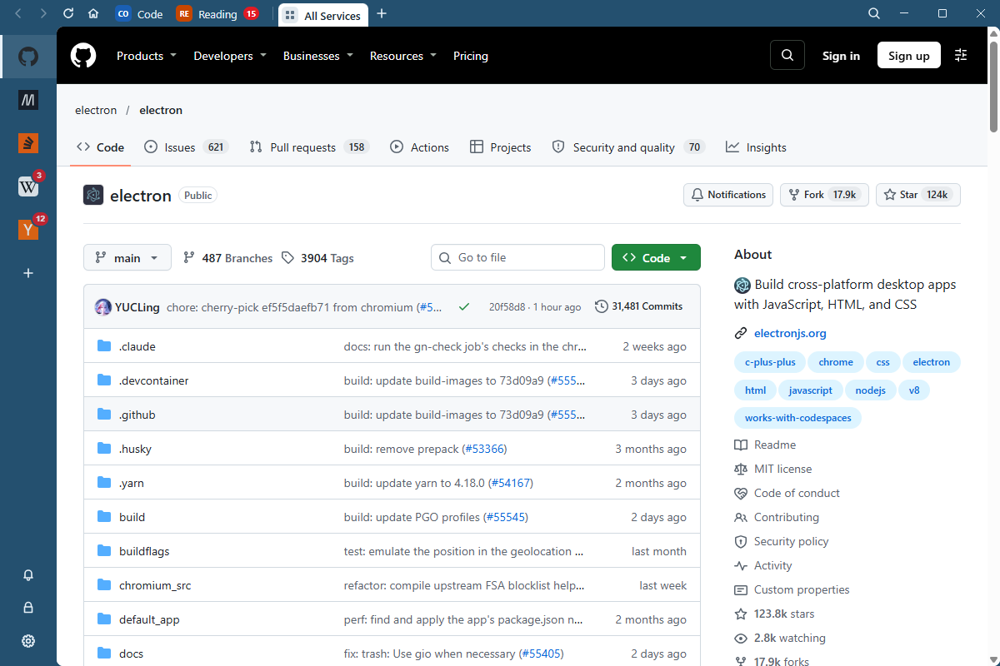
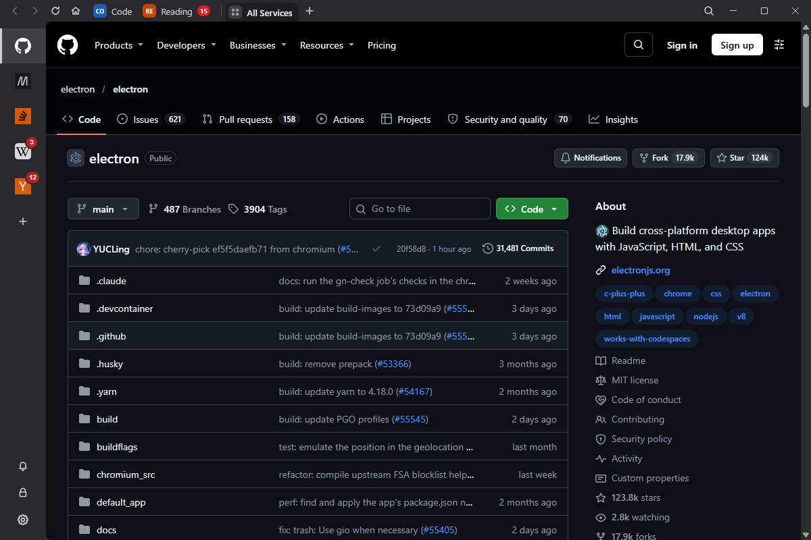

<div align="center">
  
  <h1>Tesselium</h1>
  <p>All your web apps in one window, with workspaces and unread counts.</p>
</div>

<p align="center">
  
  
</p>

<p align="center">
  <a href="https://github.com/lukasborges/tesselium/releases/latest"><strong>Download the latest release</strong></a><br />
  Linux · Windows · macOS · GPLv3
</p>

Tesselium puts the web apps you already use in the browser in one window, with workspaces to keep them apart and unread counts on every icon. There is no account and no server, and it is free and open source.

## Features

- **Any web app.** WhatsApp, Gmail, Slack, Teams, Claude, or any address you type. More than 50 common ones are a click away.
- **Workspaces.** Group your services into tabs, each signed in on its own, to keep work and personal apart or to use two accounts of the same site.
- **Unread counts.** Every icon shows what is waiting, and every workspace tab adds up its own.
- **Notifications.** On or off and with or without sound for each service, plus a do-not-disturb switch for all of them.
- **Links stay in the app.** They open already signed in, and a link to another service you added opens in that service. `Ctrl`+click opens it in your browser instead.
- **The browser basics.** Back, forward, reload, find, zoom, spell checking and screen sharing.
- **A lock screen** with a password, and an icon in the system tray.
- **Light and dark**, or following the system.
- **Automatic updates** on Linux and Windows.
- **Ten languages.** English, Portuguese, Spanish, French, German, Italian, Russian, Japanese, Chinese and Korean.
- **Every service works the same way.** Nothing is tailored to one site, so there is no per-site code to go stale when a site changes.

## Install

Download the latest release from [Releases](https://github.com/lukasborges/tesselium/releases): an AppImage, a deb or a tarball for Linux, an installer or a zip for Windows, and a disk image or a zip for Macs with Apple silicon or Intel. Windows 10 or 11 and macOS 13 Ventura or later are supported.

### Linux

The AppImage needs FUSE 2: `fuse-libs` on Fedora, `libfuse2t64` on Ubuntu 24.04 and later, `libfuse2` on Debian. Without it, run the AppImage with `--appimage-extract-and-run`.

### Windows

The installer needs no administrator rights. The zip is the same app, with nothing to install.

### macOS

Download `Tesselium-<version>-mac-arm64.dmg` for a Mac with Apple silicon, `Tesselium-<version>-mac-x64.dmg` for one with Intel. Open the disk image and drag Tesselium to Applications. On a Mac, Check for Updates opens the latest release.

### First launch on Windows and macOS

Tesselium is not code-signed, so the first launch is held back once.

- **Windows:** SmartScreen appears. Choose **More info**, then **Run anyway**. For the zip, tick **Unblock** in the downloaded file's properties before extracting.
- **macOS:** open **System Settings › Privacy & Security** and choose **Open Anyway** beside Tesselium.

## Upgrading

- **From Shep or Tessely:** Tesselium is the same app under a new name. The first start moves the earlier folder over, with every service, workspace and sign-in in it, and on Windows, or from the deb, installing Tesselium replaces the earlier app. On a Mac or with the AppImage, remove it once Tesselium has started.
- **From 1.5.1 or earlier:** sign-ins now belong to workspaces, and the first start carries them over. A service that had a sign-in of its own may ask you to sign in again.
- **From 0.10 or earlier:** 1.0 starts from a clean profile, so services have to be added again.

## Keyboard

| Keys | Action |
|---|---|
| `Ctrl+1` … `Ctrl+9` | The first nine services in the rail |
| `Ctrl+Tab`, `Ctrl+Shift+Tab` | The next and the previous service |
| `Ctrl+Alt+1` … `Ctrl+Alt+9` | A workspace by position; the key after the last opens All Services |
| `Alt+←`, `Alt+→` | Back and forward in the page |
| `Ctrl+R`, `F5` | Reload, and `Ctrl+Shift+R` without the cache |
| `Ctrl+F` | Find in page |
| `Ctrl+=`, `Ctrl+-`, `Ctrl+0` | Zoom in, out, back to actual size |
| `Ctrl+N` | Add a service |
| `Ctrl+,` | Preferences |
| `Ctrl+Shift+I` | Developer tools |
| `Alt+Shift+D` | Do not disturb |
| `Alt+Shift+L` | Lock |
| `F11` | Full screen |
| `Ctrl+Q` | Quit |

On a Mac, `⌘` takes the place of `Ctrl`, and `⌥` of `Alt`. The Mac also has `⌘[` and `⌘]` for back and forward, `⌥⌘I` for the developer tools, and `⌃⌘F` for full screen.

## Privacy

- **Your data stays on your machine.** Services, workspaces, preferences and sign-ins are kept in Tesselium's folder: `~/.config/Tesselium` on Linux, `%APPDATA%\Tesselium` on Windows, `~/Library/Application Support/Tesselium` on a Mac.
- **Tesselium sends nothing about you.** It only checks GitHub for updates and downloads a spell-checking dictionary from Google the first time a language needs one. What each service does is up to the service.
- **Camera, microphone and screen sharing** are asked about once per service, and the answer is remembered. Other permissions are refused.
- **The lock** hides the window's contents. It does not encrypt the sign-ins on disk.

## Troubleshooting

- **A count looks wrong.** Preferences › Advanced › Unread Report shows where each service's count comes from.
- **A site refuses a sign-in.** Leave User agent empty in Preferences › Advanced.
- **The AppImage does not start.** Install FUSE 2; see [Linux](#linux).
- **The first launch is blocked.** See [First launch on Windows and macOS](#first-launch-on-windows-and-macos).
- **Ubuntu 24.04 aborts at start with a sandbox error.** Start Tesselium with `--no-sandbox`. The Linux packages already do.

## Development

Node 22 or later and npm.

```bash
npm install
npm start               # the app, with the interface reloading as you edit
npm test                # typecheck, lint, build, unit tests, then the end-to-end suite
npm run package         # the packages for the system you are on, into dist/
```

A run from the repository uses its own profile, `Tesselium-dev`, and never touches the installed app's. The end-to-end suite launches the real app and opens its windows; on Linux, with `xvfb-run` installed, they open on a virtual display. `npm run test:network` adds the tests that load real sites.

## Support

Bugs and feature requests go to [Issues](https://github.com/lukasborges/tesselium/issues), or Preferences › Advanced › Report an Issue. Say what happened, on which system, and, for a service that misbehaves, which address you added.

See [CONTRIBUTING.md](./CONTRIBUTING.md) before sending a change.

## Credits

Tesselium began as a fork of [Rambox Community Edition](https://github.com/ramboxapp/community-edition), archived in 2022, and 1.0 is a rewrite that keeps none of its code. The idea that every service should work the same way comes from [ElectronIM](https://github.com/manusa/electronim). The workspace icons are from [Lucide](https://lucide.dev).

Tesselium is not affiliated with any of the services it opens.

## Licence

[GNU GPL v3](./LICENSE).
